# Домашнее задание: Скрипты на Bash (слайды 1–25, до циклов)

## Цель работы
Повторить все примеры из презентации «Скрипты на Bash» до темы циклов и продемонстрировать их выполнение в терминале Linux.

---

## Выполненные скрипты

### 1. Первый скрипт (`myscript.sh`) — слайды 1–3
Создание файла, добавление shebang `#!/bin/bash`, комментария и команд `pwd`, `whoami`. Установка прав на выполнение через `chmod +x` и запуск через `./myscript.sh`.

### 2. Вывод сообщений (`greet.sh`) — слайд 4
Использование команды `echo` для вывода поясняющего текста перед выполнением `pwd` и `whoami`.

### 3. Переменные среды (`env.sh`) — слайд 5
Использование системной переменной `$HOME` внутри двойных кавычек для вывода домашнего каталога пользователя.

### 4. Специальные символы (`special.sh`) — слайд 6
Экранирование символа доллара с помощью обратного слеша `\$` для его корректного вывода в тексте.

### 5. Пользовательские переменные (`vars.sh`) — слайд 7
Объявление и использование собственных переменных (`grade=5`, `person="Adam"`) в скрипте.

### 6. Подстановка команд (`substitution.sh`) — слайды 8–9
Извлечение результата выполнения команды `pwd` с помощью конструкции `$(pwd)` и сохранение его в переменную `mydir`.

### 7. Математические операции (`math.sh`) — слайд 10
Вычисление арифметических выражений с использованием конструкции `$(( ))` (сложение и умножение).

### 8. Условный оператор if-then (`if_basic.sh`) — слайды 11–13
Проверка условия: поиск пользователя `ali` в файле `/etc/passwd` с помощью `grep`. Если пользователь найден, выводится сообщение.

### 9. Оператор if-then-else (`if_else.sh`) — слайд 14
Добавление ветки `else` для обработки случая, когда пользователь (например, `anotherUser`) не найден в системе.

### 10. Сравнение чисел (`num_compare.sh`) — слайды 16–17
Использование числового оператора `-gt` (greater than) в конструкции `if [ ... ]` для сравнения значений.

### 11. Сравнение строк и экранирование (`str_compare.sh`) — слайды 18–21
Лексикографическое сравнение строк с использованием оператора `\>` с обязательным экранированием, чтобы избежать конфликтов с перенаправлением вывода.

### 12. Проверки файлов (`file_check.sh`) — слайды 24–25
Использование файлового оператора `-d` для проверки существования директории (например, `/home/ali`) и вывода её содержимого через `ls`.

---

## Скриншоты выполнения

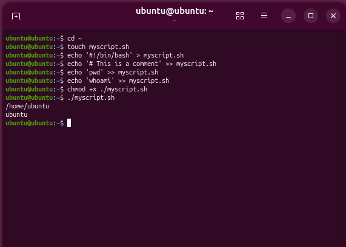
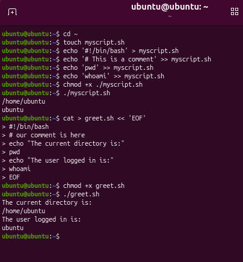
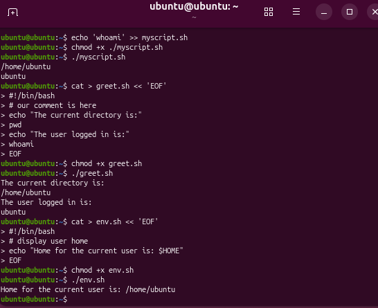
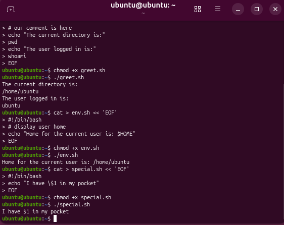
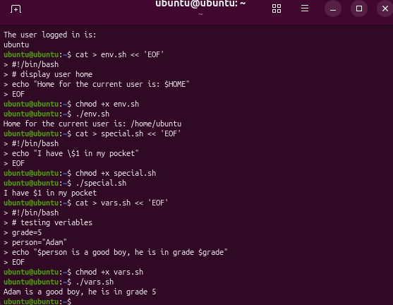
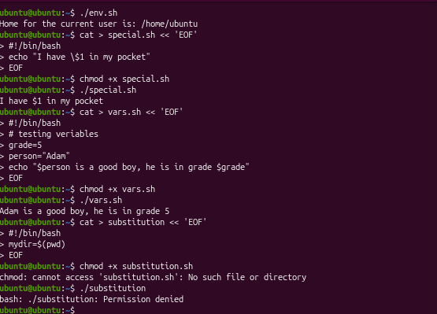
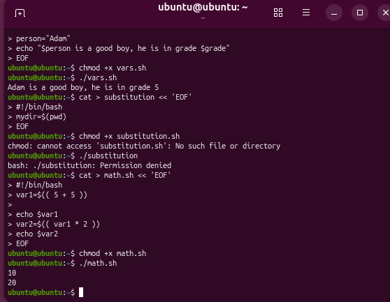
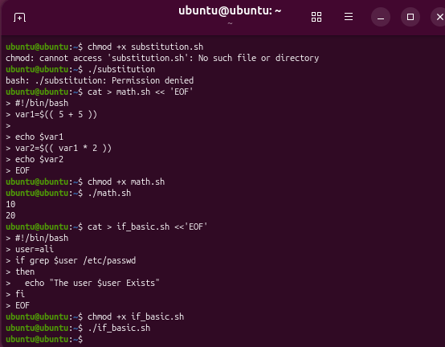
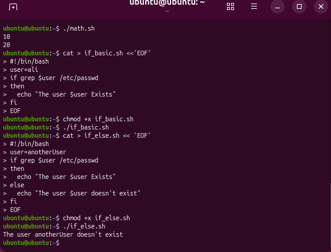
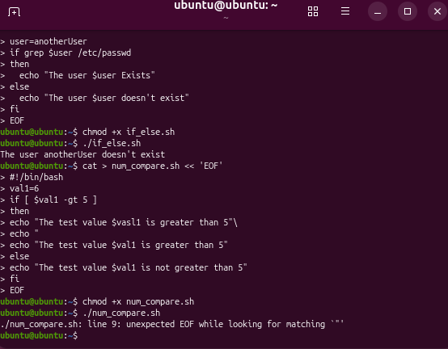
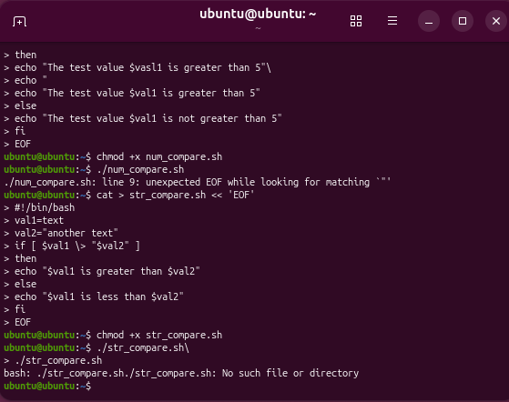
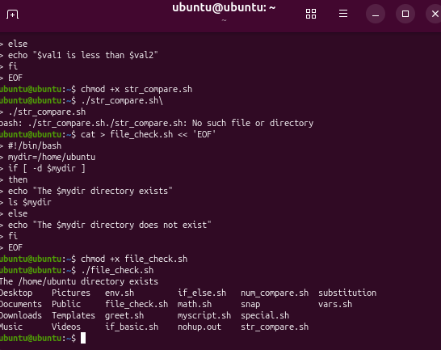

---

## Вывод
Все темы презентации «Скрипты на Bash» до раздела «Циклы» успешно изучены и выполнены на практике:
- Создание и запуск bash-скриптов (shebang, chmod +x)
- Работа с переменными (системными и пользовательскими)
- Подстановка команд и математические операции
- Условные операторы (if-then, if-then-else)
- Сравнение чисел и строк
- Проверки атрибутов файлов

Задание выполнено в полном объеме.
