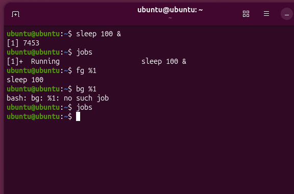
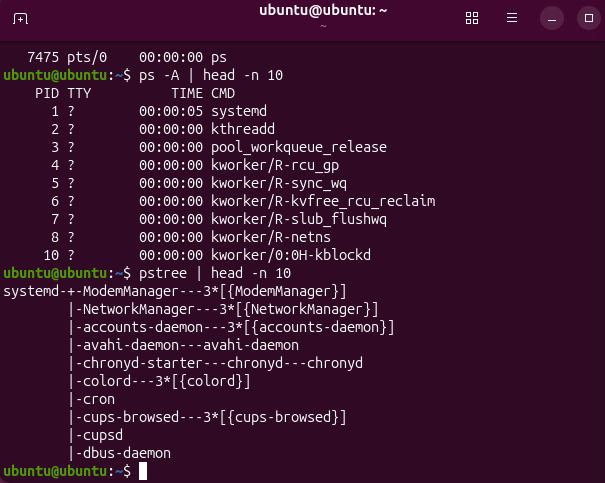
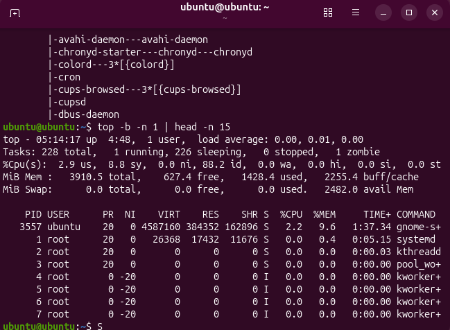
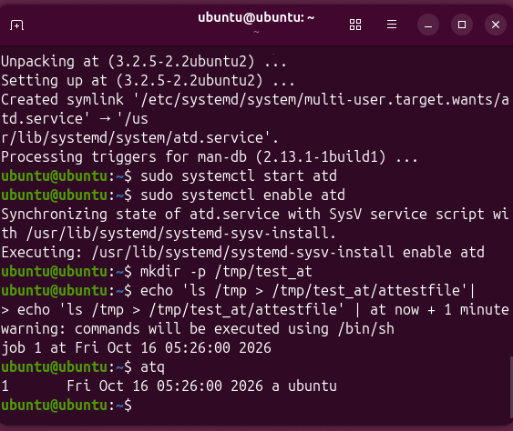
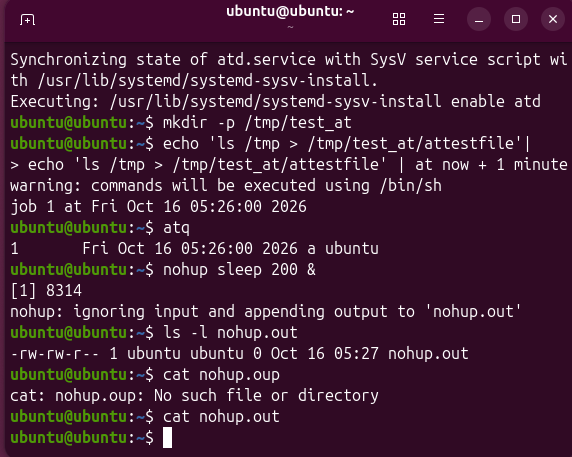
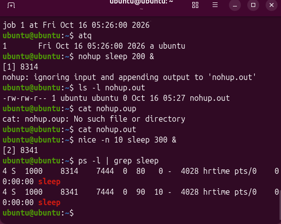
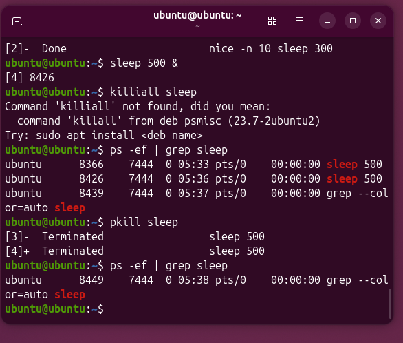

# Домашнее задание: Процессы в Linux. Команды для работы с процессами

## Цель работы
Повторить все операции из презентации «Лекция 4. Процессы в Linux. Команды для работы с процессами» и показать примеры их выполнения.

---

## Выполненные операции

### 1. Запуск на переднем и фоновом плане
Использованы команды `&` (фон), `jobs` (список фоновых задач), `fg` (на передний план), `Ctrl+Z` (остановка), `bg` (продолжение в фоне).

### 2. Команды ps и pstree
- `ps` — вывод списка процессов текущего терминала
- `ps -A` — вывод всех процессов в системе
- `pstree` — отображение иерархии процессов в виде дерева

### 3. Команда top
`top -b -n 1` — отображение информации о процессах и загрузке системы в пакетном режиме (без интерактива).

### 4. Команда at
`at` — выполнение команд в заданное время в будущем. Требует установленного пакета `at` и запущенной службы `atd`.

### 5. Команда nohup
`nohup` — запуск программы, которая продолжает работать после выхода из оболочки. Вывод перенаправляется в файл `nohup.out`.

### 6. Команды nice и renice
- `nice -n 10` — запуск команды с заданным относительным приоритетом (10)
- `ps -l` — проверка значения NI (nice) в выводе

### 7. Сигналы. Команды kill и pkill
- `kill PID` — отправка сигнала процессу по его PID (по умолчанию SIGTERM)
- `pkill` — завершение процессов по имени (использована вместо `killall`, так как пакет `psmisc` не работал корректно)

---

## Скриншоты выполнения

## Вывод
Все команды для работы с процессами в Linux изучены и выполнены на практике: запуск в фоне/на переднем плане, просмотр процессов (`ps`, `top`, `pstree`), планирование (`at`), запуск без привязки к терминалу (`nohup`), управление приоритетами (`nice`), завершение процессов (`kill`, `pkill`).
