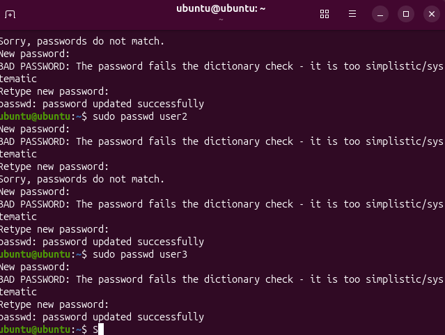
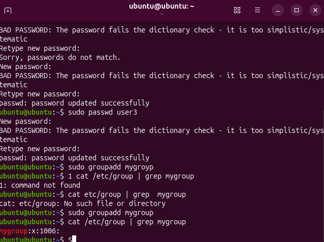
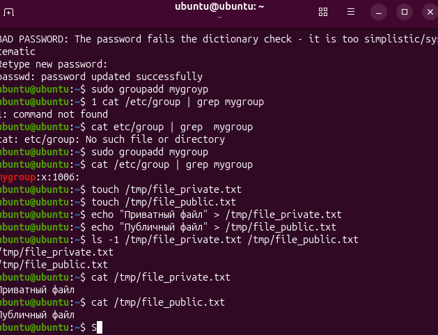
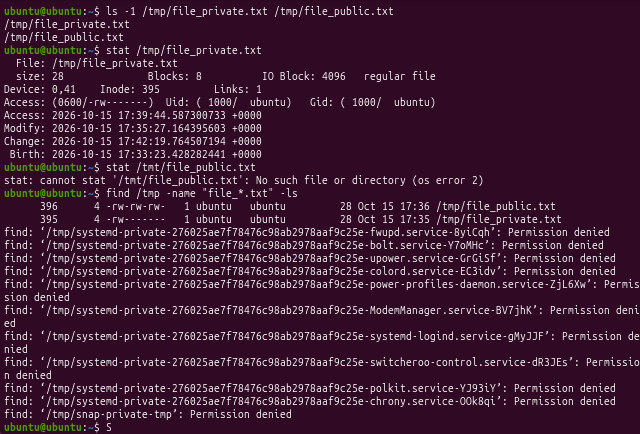
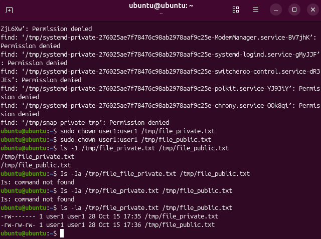
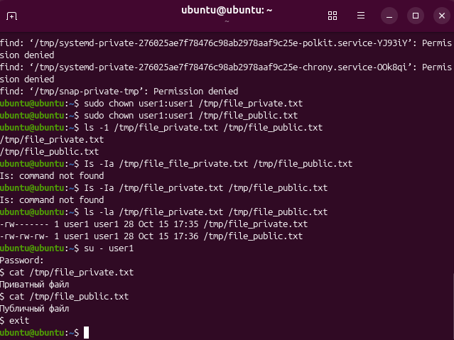
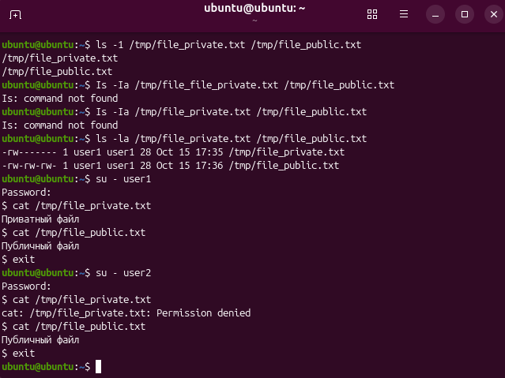
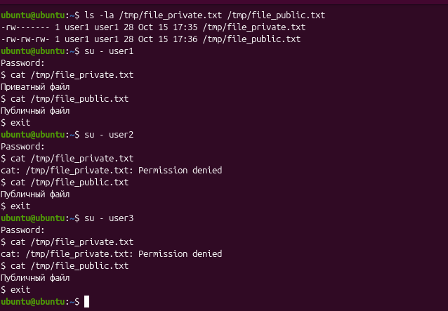
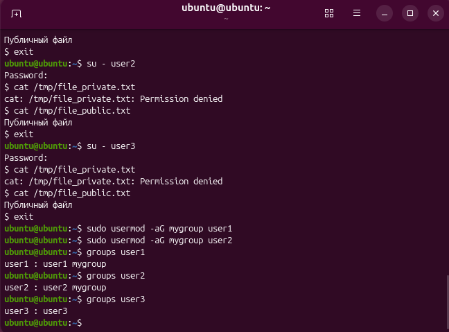

# Домашнее задание: Пользователи, группы и права доступа в Linux

## Цель работы
Создать 3 пользователей и 1 группу, настроить права доступа к файлам и протестировать их работу.

## Выполненные шаги

### Шаг 1: Создание 3 пользователей
Созданы пользователи `user1`, `user2`, `user3` командой `useradd`. Установлены пароли.

### Шаг 2: Создание группы
Создана группа `mygroup`.

### Шаг 3: Создание 2 файлов
Созданы файлы `file_private.txt` и `file_public.txt`.

### Шаг 4: Настройка прав доступа
- `chmod 600` для приватного файла (только владелец)
- `chmod 666` для публичного файла (все)

### Шаг 5: Смена владельца
Владелец файлов изменён на `user1` командой `chown`.

### Шаг 6: Тест от user1 (владелец)
user1 читает оба файла успешно.

### Шаг 7: Тест от user2 (не владелец)
- file_private.txt → Permission denied ❌
- file_public.txt → успешно ✅

### Шаг 8: Тест от user3 (не владелец)
- file_private.txt → Permission denied 
- file_public.txt → успешно ✅

### Шаг 9: Добавление в группу
user1 и user2 добавлены в группу `mygroup`.

## Вывод
Задание выполнено. Права доступа работают корректно.
